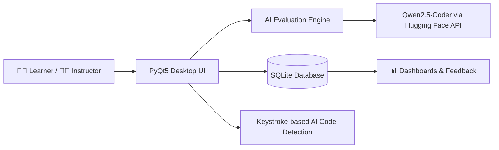

<p align="center">
  <a href="https://git.io/typing-svg">
    
  </a>
</p>

<p align="center">
  
  
  
</p>

---

## 💻 `whoami`

```bash
$ whoami
rida_anjum

$ cat profile.json
```

```json
{
  "name": "Rida Anjum",
  "role": "Aspiring AI Engineer | Python Developer",
  "education": "B.E. in AI & ML @ New Horizon College of Engineering (2025-2028)",
  "background": ["Gaming & Animation", "UI/UX Design", "AI & ML"],
  "languages_spoken": ["English", "Kannada", "Hindi", "Urdu"],
  "currently_learning": ["Machine Learning", "Data Analysis", "DSA"],
  "mission": "Build intelligent, user-friendly AI products",
  "status": "Building in public 🚀"
}
```

---

## ⚡ Tech Stack

<p align="center">
  
</p>

<p align="center">
  
  
  
  
  
  
</p>

---

## 🚀 Featured Project

### 🧑‍💻 AI-Assisted Python Coding Learning Platform

A desktop learning platform with AI-powered code evaluation and adaptive hints, plus dashboards for learners and instructors.



| Feature | Details |
|---|---|
| 🤖 **AI Evaluation** | Code assessment and adaptive hint generation with Qwen2.5-Coder |
| ⌨️ **Integrity Check** | Keystroke-based detection of AI-generated code |
| 👥 **Access Control** | Role-based user management (learner / instructor) |
| 📊 **Dashboards** | Automated assessment and feedback views |

<p>
  
  
  
  
  
</p>

👉 [**View Repository**](https://github.com/rida-200520/python-learning-platform)

---

## 🗺️ Roadmap

- [x] Python, Java, SQL and OOP fundamentals
- [x] Built an AI-powered desktop application
- [ ] Build ML projects with Scikit-learn and Pandas
- [ ] Data analysis and visualization projects
- [ ] Strengthen DSA on LeetCode and HackerRank
- [ ] Deep learning and NLP projects

---

## 📊 GitHub Analytics

<p align="center">
  
  
</p>

<p align="center">
  
</p>

<p align="center">
  
</p>

---

## 🏅 Certifications

| 🎓 Certification | 🏢 Issuer |
|---|---|
| Software Engineering Job Simulation | Forage |
| Cybersecurity Essentials | Cisco Networking Academy |
| Networking Basics | Cisco Networking Academy |
| AI Tools Workshop | BE10X |
| Game Design & Development | MSME IDEMI |
| UI/UX Design Workshop | Arena Animation |

---

## 📡 Connect

<p align="center">
  <a href="https://www.linkedin.com/in/ridanjum2005/"></a>
  <a href="mailto:ridanjum@gmail.com"></a>
  <a href="https://leetcode.com/u/ridanjum2005/"></a>
  <a href="https://www.hackerrank.com/profile/ridanjum2005"></a>
</p>


